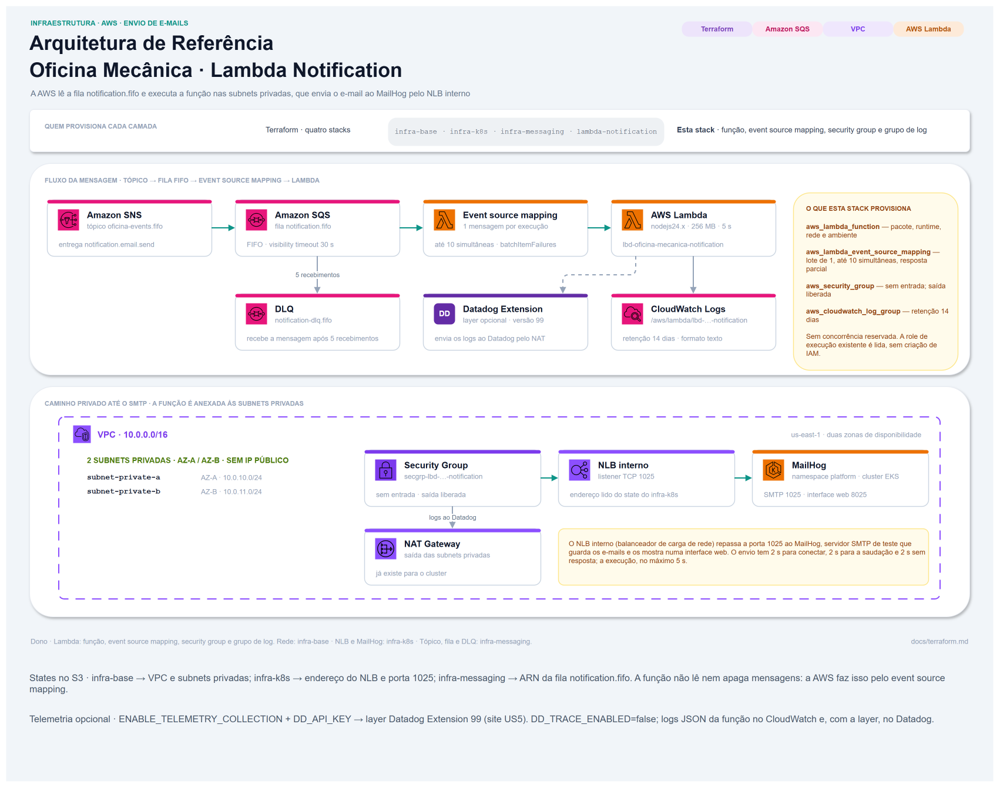

# Infraestrutura

A infraestrutura desta função é escrita em Terraform e fica em `infra/`, no
mesmo repositório do código: uma mudança na função e na configuração dela passa
pela mesma revisão.



## O que esta stack cria

| Recurso | Dono | Observação |
| --- | --- | --- |
| Função Lambda `lbd-oficina-mecanica-notification` | **este repositório** | O código publicado e a configuração dele |
| *Event source mapping* da fila `notification.fifo` | **este repositório** | A ligação que faz a AWS Lambda ler a fila e executar a função: uma mensagem por execução, até 10 execuções ao mesmo tempo, resposta parcial `batchItemFailures` |
| Security group `secgrp-lbd-oficina-mecanica-notification` | **este repositório** | O firewall da função: nenhuma entrada, saída liberada |
| Grupo de log `/aws/lambda/lbd-oficina-mecanica-notification` | **este repositório** | Declarado para ter retenção de 14 dias; sem isso, a AWS o criaria guardando logs para sempre |
| VPC e subnets privadas | `oficina-mecanica-infra-base` | Lidas do state desse repositório |
| NLB interno e a porta SMTP do MailHog | `oficina-mecanica-infra-k8s` | Lidos do state desse repositório |
| Tópico, fila `notification.fifo` e DLQ | `oficina-mecanica-infra-messaging` | Lidos do state desse repositório; retenção, criptografia e DLQ são configuradas lá |
| Bucket S3 dos states | compartilhado por todos os repositórios Terraform | Já existe; esta stack só acrescenta o próprio arquivo de state |
| Role IAM de execução | **ninguém** — a conta AWS da solução não permite criar roles | Lida por fonte de dados (`data`), nunca criada |

A função não tem concorrência reservada (uma cota da conta separada só para
ela) — ver [ADR 0002](adr/0002-uma-mensagem-por-invocacao.md).

## Dados lidos de outros repositórios

O Terraform guarda num arquivo de *state* o que cada stack criou e os valores
que ela publica (*outputs*). Esta stack lê os outputs de outras três por
`terraform_remote_state`, em vez de receber esses valores digitados:

| Origem | Arquivo de state no bucket | O que esta stack lê |
| --- | --- | --- |
| `oficina-mecanica-infra-base` | `infra/prod-simulated/infra-base/terraform.tfstate` | `vpc_id`, `private_subnet_ids` |
| `oficina-mecanica-infra-k8s` | `infra/prod-simulated/infra-k8s/terraform.tfstate` | `nlb_dns_name` (endereço do NLB), `smtp_listener_port` (1025) |
| `oficina-mecanica-infra-messaging` | `infra/prod-simulated/infra-messaging/terraform.tfstate` | `queue_arns["notification"]` (ARN da fila) |

As variáveis com o nome do bucket de cada state (`aws_base_state_bucket`,
`k8s_state_bucket`, `messaging_state_bucket`) não têm valor padrão. Nos
workflows, elas recebem a variable `TF_STATE_BUCKET` da organização no GitHub,
por variáveis de ambiente `TF_VAR_*`.

## Onde fica o state desta stack

```hcl
key          = "infra/prod-simulated/lambda-notification/terraform.tfstate"
region       = "us-east-1"
encrypt      = true
use_lockfile = true
```

O `backend.tf` não declara o bucket: os workflows o informam no `terraform init`
com `-backend-config="bucket=$TF_STATE_BUCKET"`. `use_lockfile` grava um arquivo
de trava no próprio bucket enquanto um `apply` roda, para que dois não rodem ao
mesmo tempo.

O `.terraform.lock.hcl`, que fixa as versões dos providers (`aws` 6.71.0 e
`archive` 2.8.1), é versionado e tem os hashes para Linux (onde o CI roda) e
Windows.

## Ordem de aplicação

```
infra-base  ──→  infra-k8s  ────────┐
            └─→  infra-messaging  ──┴─→  lambda-notification
```

Se o infra-k8s não publicar `smtp_listener_port`, ou o infra-messaging não
publicar `queue_arns["notification"]`, a leitura falha e nada desta stack é
planejado.

## Configuração da função

| Parâmetro | Valor | Motivo |
| --- | --- | --- |
| Runtime | `nodejs24.x` | Mesma versão do Node.js usada no projeto e no build |
| Ponto de entrada | `handler.handler` | A função `handler` do arquivo `handler.js`, na raiz do pacote |
| Memória | 256 MB | Um envio SMTP por execução, sem processamento pesado |
| Tempo limite | **5 s** | Um envio cabe com folga: o SMTP tem até 2 s por etapa. O *visibility timeout* da fila (30 s) fica seis vezes acima, como a AWS recomenda |
| Formato de log | texto | No formato JSON da AWS Lambda, cada linha da função seria embrulhada num JSON da AWS, e o formato da linha mudaria |
| Retenção do log | 14 dias | Igual à da customer-auth |
| Publicação de versão | ligada | Cada mudança publica uma versão numerada da função, para rastrear o que está em produção; o event source mapping executa sempre a mais recente |
| Rede | subnets privadas, security group só com saída | O NLB interno só é alcançável de dentro da VPC |

| Event source mapping | Valor | Significa |
| --- | --- | --- |
| `batch_size` | `1` | Uma mensagem por execução |
| `scaling_config.maximum_concurrency` | `10` | No máximo 10 execuções ao mesmo tempo |
| `function_response_types` | `["ReportBatchItemFailures"]` | A função devolve só as mensagens que falharam, e as outras são confirmadas |

## Variáveis de entrada do Terraform

São 26 variáveis; 23 têm valor padrão. As três sem padrão são os nomes dos
buckets de state, que vêm de `TF_STATE_BUCKET` nos workflows ou de `export` na
execução local.

| Variável | Tipo | Padrão | Uso |
| --- | --- | --- | --- |
| `aws_region` | `string` | `us-east-1` | Região dos recursos e do ARN da layer do Datadog |
| `project_name` | `string` | `oficina-mecanica` | Compõe o nome do security group e as tags |
| `environment` | `string` | `prod-simulated` | Tag `Environment`; `NODE_ENV` e `DD_ENV` continuam `production` |
| `aws_base_state_bucket` | `string` | — | Bucket do state do infra-base |
| `aws_base_state_key` | `string` | `infra/prod-simulated/infra-base/terraform.tfstate` | Arquivo que publica VPC e subnets privadas |
| `aws_base_state_region` | `string` | `us-east-1` | Região do bucket |
| `k8s_state_bucket` | `string` | — | Bucket do state do infra-k8s |
| `k8s_state_key` | `string` | `infra/prod-simulated/infra-k8s/terraform.tfstate` | Arquivo que publica o NLB e a porta SMTP |
| `k8s_state_region` | `string` | `us-east-1` | Região do bucket |
| `messaging_state_bucket` | `string` | — | Bucket do state do infra-messaging |
| `messaging_state_key` | `string` | `infra/prod-simulated/infra-messaging/terraform.tfstate` | Arquivo que publica o ARN da fila |
| `messaging_state_region` | `string` | `us-east-1` | Região do bucket |
| `function_name` | `string` | `lbd-oficina-mecanica-notification` | Nome da função, do grupo de log e tag `Name` |
| `lambda_execution_role_name` | `string` | `LabRole` | Nome da role IAM existente que a função usa |
| `lambda_runtime` | `string` | `nodejs24.x` | Precisa ser a mesma versão do build (`node24`) |
| `lambda_memory_size` | `number` | `256` | Memória em MB |
| `lambda_timeout` | `number` | `5` | Tempo limite em segundos |
| `log_retention_in_days` | `number` | `14` | Dias de retenção do log |
| `mail_from` | `string` | `Oficina Mecânica <noreply@oficina.local>` | Remetente de todo e-mail (`MAIL_FROM`) |
| `service_version` | `string` | `dev` | O CD passa o commit: vira `SERVICE_VERSION`, `DD_VERSION` e a tag `ServiceVersion` |
| `enable_telemetry_collection` | `bool` | `false` | Anexa a layer do Datadog e as variáveis `DD_*` |
| `telemetry_api_key` | `string`, sensível | `""` | Vira `DD_API_KEY`; fica gravada no state |
| `telemetry_site` | `string` | `us5.datadoghq.com` | `DD_SITE` |
| `telemetry_extension_layer_account_id` | `string` | `464622532012` | Conta AWS que publica a layer do Datadog |
| `telemetry_extension_layer_name` | `string` | `Datadog-Extension` | Nome da layer |
| `telemetry_extension_layer_version` | `number` | `99` | Versão da layer |

## Variáveis de ambiente da função

| Variável | Origem |
| --- | --- |
| `NODE_ENV` | fixa: `production` |
| `SMTP_HOST` | `nlb_dns_name`, do infra-k8s |
| `SMTP_PORT` | `smtp_listener_port`, do infra-k8s (1025) |
| `MAIL_FROM` | variável `mail_from` |
| `NODE_OPTIONS` | fixa: `--enable-source-maps`, para a pilha de uma exceção apontar o arquivo `.ts` original |
| `SERVICE_VERSION` | variável `service_version`; o commit, quando aplicada pelo CD |
| `DD_API_KEY`, `DD_SITE`, `DD_ENV`, `DD_SERVICE`, `DD_VERSION`, `DD_SERVERLESS_LOGS_ENABLED`, `DD_TRACE_ENABLED` | só com a coleta ligada — ver [Observabilidade](observability.md) |

Não há credencial de banco, de SMTP nem de fila: a função não usa nenhuma.

## O pacote

O `.zip` publicado é gerado pelo `archive_file` do Terraform a partir de
`app/dist`, na hora de aplicar. O `archive_file` zera as datas dos arquivos, então
o hash do pacote só muda quando o conteúdo muda. Ele não normaliza as permissões
dos arquivos, que variam entre sistemas operacionais; por isso o
`output_file_mode` é fixado. Mesmo assim, uma prévia feita no Windows pode
mostrar o pacote como alterado sem mudança de código.

## Como Executar Localmente

```bash
# A partir da raiz do clone, entrar na stack
cd infra
# Conferir a formatação e baixar os providers sem acessar o state remoto
terraform fmt -check -recursive
terraform init -backend=false
# Validar a configuração; não lê os states nem chama a AWS
terraform validate
```

Esses três comandos não precisam de credenciais AWS.

Para ver o plano (`terraform plan`) são necessários credenciais AWS válidas, as
três stacks de origem já aplicadas e o pacote gerado, porque o `archive_file` lê
`app/dist`:

```bash
# A partir da raiz do clone, gerar o pacote que o archive_file lê
cd app
npm ci
npm run build
# Com credenciais AWS válidas no ambiente
cd ../infra
export TF_STATE_BUCKET="<nome do bucket>"
export TF_VAR_aws_base_state_bucket="$TF_STATE_BUCKET"
export TF_VAR_k8s_state_bucket="$TF_STATE_BUCKET"
export TF_VAR_messaging_state_bucket="$TF_STATE_BUCKET"
terraform init -reconfigure -backend-config="bucket=$TF_STATE_BUCKET"
# Mostrar o que seria criado ou alterado, sem aplicar
terraform plan
```

Quem aplica é o CD, que também verifica a função depois — ver
[CI/CD](ci-cd.md#entrega-contínua). Para remover a função, execute o workflow CD
manualmente com `action=destroy`. A remoção não apaga a fila; as mensagens
ficam nela até vencer a retenção de 1 dia.

## Outputs

| Output | Uso |
| --- | --- |
| `function_name` | O CD usa para executar a função na verificação depois do deploy |
| `function_arn` | Identificação da função |
| `function_version` | O CD registra no resumo da entrega |
| `log_group_name` | Consulta de logs no CloudWatch |
| `event_source_mapping_uuid` | Conferir a ligação com a fila: `aws lambda get-event-source-mapping --uuid <valor>` |
| `queue_arn` | O CD monta a mensagem de teste e registra a fila no resumo |

Nenhuma outra stack lê estes outputs.
